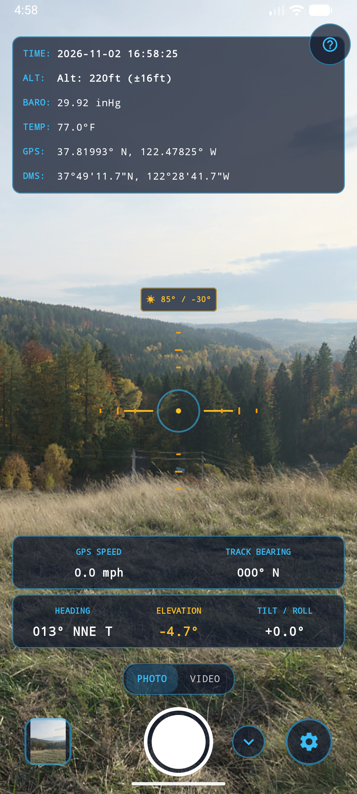
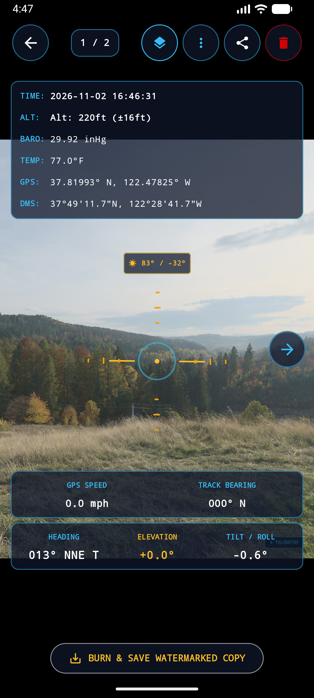
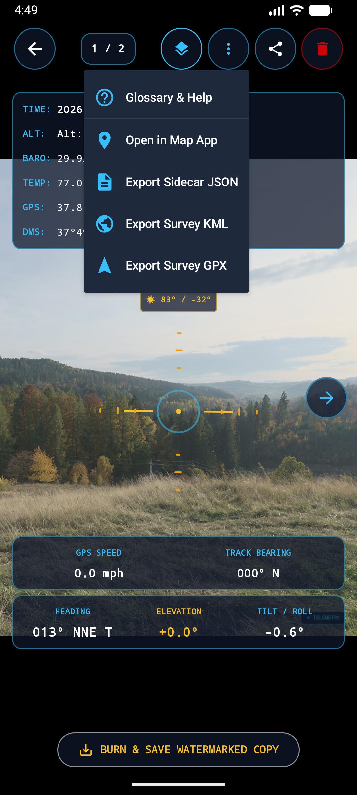
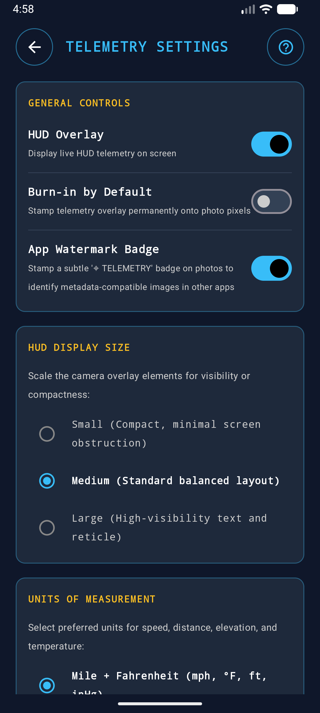
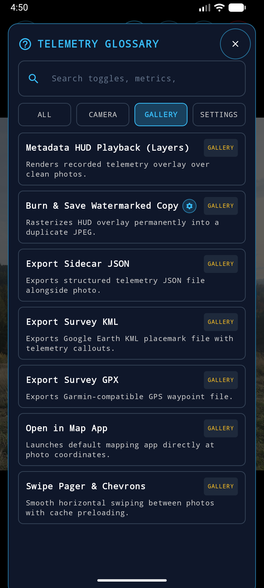

# Telemetry Camera — User Guide

A visual guide to the screens, features, sensors, and telemetry overlay capabilities of **Telemetry Camera**.

---

## Table of Contents
1. [Overview](#overview)
2. [Screen 1: Live Camera Viewfinder](#screen-1-live-camera-viewfinder)
   - [Top Telemetry Banner](#top-telemetry-banner)
   - [Artificial Horizon & Pitch Ladder](#artificial-horizon--pitch-ladder)
   - [Cockpit & Kinematics Cards](#cockpit--kinematics-cards)
   - [Camera Controls](#camera-controls)
3. [Screen 2: Telemetry Gallery Viewer](#screen-2-telemetry-gallery-viewer)
   - [Interactive HUD Overlay Playback](#interactive-hud-overlay-playback)
   - [Tools & GIS Export Menu](#tools--gis-export-menu)
   - [Burn-in Watermarked Copy Generator](#burn-in-watermarked-copy-generator)
4. [Screen 3: Settings & Configuration](#screen-3-settings--configuration)
   - [General & Watermark Controls](#general--watermark-controls)
   - [Display Size & Coordinate Modes](#display-size--coordinate-modes)
   - [Compass & True North Declination](#compass--true-north-declination)
   - [Advanced Field Survey Tools](#advanced-field-survey-tools)
5. [Synchronized Video Capture & Telemetry Subtitles (.SRT)](#synchronized-video-capture--telemetry-subtitles-srt)
6. [In-App Feature: Searchable Telemetry Glossary](#in-app-feature-searchable-telemetry-glossary)
7. [EXIF & Sidecar Metadata Specifications](#exif--sidecar-metadata-specifications)
8. [Sample Field Use Cases & Phototheodolite Workflows](#sample-field-use-cases--phototheodolite-workflows)
   - [Use Case 1: Two-Point Triangulation & Remote Structure Sizing](#use-case-1-two-point-triangulation--remote-structure-sizing)
   - [Use Case 2: Telecom Antenna Mechanical Azimuth & Downtilt Audit](#use-case-2-telecom-antenna-mechanical-azimuth--downtilt-audit)
   - [Use Case 3: Pipeline & Linear Infrastructure Corridors](#use-case-3-pipeline--linear-infrastructure-corridors)
   - [Use Case 4: Incident & Accident Timeline Reconstruction](#use-case-4-incident--accident-timeline-reconstruction)
   - [Use Case 5: Solar Farm Feasibility & Horizon Shading Analysis](#use-case-5-solar-farm-feasibility--horizon-shading-analysis)
   - [Use Case 6: Wildfire Smoke Spotting & Backcountry Initial Attack](#use-case-6-wildfire-smoke-spotting--backcountry-initial-attack)
   - [Use Case 7: Civil Engineering Plumb, Settlement & Retaining Wall Monitoring](#use-case-7-civil-engineering-plumb-settlement--retaining-wall-monitoring)
   - [Use Case 8: Forestry Timber Cruises & Hazard Tree Assessment](#use-case-8-forestry-timber-cruises--hazard-tree-assessment)
   - [Use Case 9: Insurance Claims & Storm Damage Catastrophe (CAT) Adjusting](#use-case-9-insurance-claims--storm-damage-catastrophe-cat-adjusting)
   - [Use Case 10: Drone / UAV Ground Control Point (GCP) Verification](#use-case-10-drone--uav-ground-control-point-gcp-verification)
   - [Use Case 11: Marine & Coastal Navigation Aid (AtoN) Audits](#use-case-11-marine--coastal-navigation-aid-aton-audits)

---

## Overview

Telemetry Camera is engineered for surveying, fieldwork, technical documentation, search and rescue, and outdoor navigation. It pairs high-definition still and video capture with real-time physical attitude (pitch, roll, heading), environmental sensors (barometric pressure, temperature), GPS kinematics (coordinates, altitude, speed, track course), and celestial ephemeris (Sun & Moon position).

Every photo captured with Telemetry Camera preserves **100% of sensor telemetry** inside standard EXIF tags and structured JSON, allowing lossless playback, GIS mapping, and archival verification.

---

## Screen 1: Live Camera Viewfinder

<p align="center">
  
</p>

The viewfinder features an aerospace Heads-Up Display (HUD) projected over the active camera preview.

### Top Telemetry Banner
* **Date & Timestamp**: Microsecond-accurate date and local 24-hour time (`YYYY.MM.DD  HH:MM:SS`).
* **True Altitude & Accuracy**: Current altitude above Mean Sea Level (MSL) in feet or meters (`ALT: 4861ft`), alongside the real-time horizontal GNSS 68% confidence radius (`±9.8ft`).
* **Barometric Air Pressure**: Live ambient air pressure sampled from the hardware MEMS barometer sensor in inches of mercury (`25.07 inHg`) or hectopascals (`849.0 hPa`).
* **Ambient Air Temperature**: Real-time ambient temperature in Fahrenheit (`84.2°F`) or Celsius (`29.0°C`).
* **Dual GPS Coordinates**:
  * **Decimal Degrees**: `37.81993° N, 122.47825° W` (precision GIS standard).
  * **Degrees, Minutes, Seconds (DMS)**: `37°49'11.7"N, 122°28'41.7"W` (nautical and aeronautical chart standard).

### Artificial Horizon & Pitch Ladder
* **Center Crosshair Reticle**: Boresighted to the optical center of the camera lens.
* **Pitch Ladder Wings**: Dynamic horizon wings that bank and tilt with device roll, showing the true horizontal plane regardless of perspective.
* **Angular Ranging Graduations**: Opt-in milliradian and degree tick marks on horizontal and vertical axes to estimate target height ($h = d \cdot \tan\theta$).
* **Celestial Ephemeris**: Real-time solar and lunar position indicators (`SUN: 083° / -30°`, `MOON: 130° / +67°`) showing celestial azimuth and elevation relative to the horizon.

### Cockpit & Kinematics Cards
* **HEADING**: 0°–359° compass azimuth formatted with 16-point cardinal direction (`293° WNW`). Selectable between **Magnetic North** and **True Geographic North** (NOAA WMM declination model).
* **ELEVATION (Pitch Angle)**: True optical line-of-sight elevation angle from ground nadir (-90°) to zenith (+90°), with 0.0° at the true horizon.
* **TILT / ROLL**: Lateral leveling angle (`ROLL: +0.3°`) indicating left/right camera banking.
* **SPEED**: Ground velocity computed via GPS Doppler kinematics in `mph` or `km/h`.
* **TRACK BEARING**: True course-over-ground travel vector (`TRACK: 142° SE`).

### Camera Controls
* **Mode Selector (`[ PHOTO | VIDEO ]`)**: Toggle between high-res photo capture and synchronized video recording with companion `.srt` subtitle files.
* **Shutter Button**: Large center tactile button (cyan ring for photos, red dot for video).
* **Gallery Thumbnail (Bottom-Left)**: Instant shortcut to the Telemetry Gallery showing the most recent capture.
* **HUD Twisty Toggle (`⌄` / `⌃`) (Bottom-Right)**: Instantly reveals or collapses the entire live HUD overlay on the camera viewfinder with a 1-tap animated twisty.
* **Settings Gear (Bottom-Right)**: Opens the comprehensive configuration screen.
* **Quick Help (`?`) (Top-Right)**: Floating button to open the searchable Telemetry Glossary from the viewfinder at any time.
* **Tap-to-Focus & Exposure**: Tapping anywhere on the viewfinder triggers automatic focus and auto-exposure metering at that exact point.

---

## Screen 2: Telemetry Gallery Viewer

| Gallery Photo Viewer | Tools & GIS Export Menu |
| :---: | :---: |
|  |  |

The Telemetry Gallery allows you to review, inspect, export, and convert photos taken in the field.

### Interactive HUD Overlay Playback
* **Independent HUD Toggle (`Layers` icon in top bar)**: Displays the telemetry overlay reconstructed directly from the photo's saved EXIF metadata. This functions **100% independently** of whether the live viewfinder HUD was turned on or off during shooting.
* **Horizontal Swipe Pager**: Smoothly swipe between photos with beyond-viewport caching.
* **Navigation Chevrons**: Floating left and right arrows for one-tap photo sliding.
* **Fullscreen Immersion**: Tap the center of the image to hide all chrome and toolbar buttons.

### Tools & GIS Export Menu
* **Field User Guide**: Instant access to the offline field manual and phototheodolite workflows from within the gallery.
* **Glossary & Help**: Searchable glossary of all sensor mathematics, HUD toggles, and direct setting deep links.
* **Open in Map App**: One-tap launch to plot the photo's exact coordinates in Google Maps, OsmAnd, or any installed mapping app.
* **Export Sidecar JSON**: Exports `<photo_name>.json` to `Pictures/TelemetryCamera/` with all raw telemetry metrics for programmatic analysis.
* **Export Google Earth KMZ**: Packages all survey captures into a standalone `.kmz` archive bundling full-resolution photos, 3D `<Camera>` virtual viewpoints, and interactive HTML popups that open directly in Google Earth.
* **Export Survey KML**: Generates lightweight Google Earth `.kml` placemark files with 6-DoF camera orientations.
* **Export Survey GPX**: Generates standard GPS waypoint `.gpx` files compatible with Garmin GPS devices, QGIS, and ArcGIS.

### Burn-in Watermarked Copy Generator
* **"BURN & SAVE WATERMARKED COPY" Button**: Located at the bottom of the screen when viewing any clean, unburned photo.
* Tapping this button rasterizes the cyan HUD overlay permanently into a duplicate JPEG file (`TELEMETRY_BURNED_<timestamp>.jpg`), leaving the original clean photo untouched.

---

## Screen 3: Settings & Configuration

<p align="center">
  
</p>

Fine-tune every HUD card, unit of measurement, calculation model, and visual display option.

### General & Watermark Controls
* **HUD Overlay**: Master switch for the live camera viewfinder HUD.
* **Burn-in by Default**:
  * **OFF (Default)**: Saves pristine clean photos with 100% telemetry embedded in metadata.
  * **ON**: Stamps the HUD overlay permanently onto the photo pixels at full sensor resolution.
* **App Watermark Badge**: Stamps a subtle `'⌖ TELEMETRY'` badge in the top-right corner to identify metadata-compatible photos when browsing in external galleries (Google Photos, Files).

### Display Size & Coordinate Modes
* **HUD Display Size**:
  * `Small`: Scaled down (0.85×) for minimal viewfinder obstruction.
  * `Medium` (Default): Balanced tactical readability.
  * `Large`: High-visibility (1.15×) typography and expanded reticle.
* **GPS Coordinate Formats**:
  * `Both (Decimal & DMS)` (Default)
  * `Decimal Only`
  * `DMS Only`
  * `Hidden / Off`

### Compass & True North Declination
* **North Reference**:
  * `Magnetic North`: Uses device magnetometer poles.
  * `True North`: Uses GPS location and the NOAA World Magnetic Model (WMM) to calculate and apply local magnetic declination.
* **Compass Mode**: `Degrees & Cardinal`, `Degrees Only`, `Cardinal Only`, or `Hidden`.

### Advanced Field Survey Tools
* **Sun & Moon Ephemeris**: Calculates real-time solar/lunar azimuth and elevation coordinates.
* **Angular Ranging Grid**: Calibrated milliradian and degree tick marks along the horizontal and vertical boresight reticle axes.

#### Understanding & Using the Angular Ranging Grid
The reticle grid utilizes **optical stadia rangefinding** (the same method used in surveying theodolites, artillery optics, and Mil-Dot tactical scopes) based on the geometric relationship between angular subtense, target size, and distance:

$$\text{Height} = \text{Distance} \times \tan(\theta)$$

1. **Estimating Object Height or Width** (when distance is known, e.g., via map or laser rangefinder):
   $$\text{Height (m)} = \frac{\text{Distance (m)} \times \text{Angular Spread in Mils}}{1000}$$
   * *Example*: You are standing 50 meters away from an antenna tower. The tower spans 80 mils on the vertical reticle. Its height is $(50 \times 80) / 1000 = 4.0\text{ meters}$.

2. **Estimating Distance to a Target** (when target size is known):
   $$\text{Distance (m)} = \frac{\text{Known Target Size (m)} \times 1000}{\text{Angular Spread in Mils}}$$
   * *Example*: A standard 2.0-meter tall vehicle spans 10 mils between the horizontal crosshair ticks. Distance to the vehicle is $(2.0 \times 1000) / 10 = 200\text{ meters}$.

3. **Leveling & Plumb Verification**: The vertical and horizontal ticks remain calibrated to true optical center, allowing immediate detection of structural tilt or leaning poles.

---

## Synchronized Video Capture & Telemetry Subtitles (.SRT)

Switch to **VIDEO** mode on the camera viewfinder using the mode toggle above the shutter button to record high-definition video with continuous sensor logging.

Telemetry Camera saves both an MP4 video file and a synchronized companion SubRip (`.srt`) subtitle file to `Movies/TelemetryCamera/`:
* `TELEMETRY_VIDEO_<timestamp>.mp4`
* `TELEMETRY_VIDEO_<timestamp>.srt`

### Per-Second Telemetry Format
Every second of recording captures real-time sensor fusion data formatted for universal media player compatibility:
```text
1
00:00:00,000 --> 00:00:01,000
HDG: 284° WNW T | PITCH: +3.7° | ROLL: +0.0°
ALT: Alt: 5280ft (±10ft) | SPD: 15.2 mph | 37.81993° N, 122.47826° W
```

### Making Good Use of Video Telemetry

#### 1. Instant Playback with Toggleable Telemetry (VLC, MPV, QuickTime)
* Keeping the `.mp4` and `.srt` in the same directory allows media players like **VLC** or **MPV** to automatically display the live telemetry at the bottom of the screen.
* **Clean Footage Preservation**: The raw camera footage remains completely un-degraded and pristine. You can toggle the telemetry overlay ON or OFF with the player's subtitle shortcut (e.g. `V` in VLC).

#### 2. Burning HUD Telemetry into Video for Deliverables (FFmpeg)
For engineering reports, client audits, or legal submissions where the telemetry must be permanently stamped into every video frame:
```bash
ffmpeg -i TELEMETRY_VIDEO_<timestamp>.mp4 \
  -vf "subtitles=TELEMETRY_VIDEO_<timestamp>.srt:force_style='Fontname=Monospace,FontSize=16,PrimaryColour=&H00FFFF,BorderStyle=3,Outline=1,Shadow=0,MarginV=25'" \
  -c:a copy TELEMETRY_BURNED_OUTPUT.mp4
```
*(You can also use HandBrake by importing the `.srt` under the Subtitles tab and selecting **Burn-in**).*

#### 3. Professional Post-Production (DaVinci Resolve / Premiere Pro / Final Cut)
* Drop the `.mp4` onto Video Track 1 and the `.srt` onto a Subtitle Track.
* Customize fonts, bounding box colors, margins, and sizes to produce broadcast-quality tactical graphics or documentary HUD overlays.

#### 4. Field Industry Applications
* **Cell Tower & Telecom Audits**: Sweep antennas while recording to log the exact mechanical azimuth (heading) and downtilt (pitch) continuously.
* **Pipeline & Infrastructure Surveys**: Record perimeter walks or drive-bys with continuous sub-meter location and orientation stamps.
* **Incident & Accident Documentation**: Verifiable second-by-second timeline tracking vehicle/vessel speed, tilt angle, direction, and coordinates.
* **Off-Road & Trail Mapping**: Record trail ascents with dynamic pitch, roll (banking angle), and elevation changes logged throughout the run.

---

## In-App Feature: Searchable Telemetry Glossary

<p align="center">
  
</p>

The built-in Telemetry Glossary is accessible via the `?` icon from **every screen** in the app (Camera Viewfinder, Settings, and Gallery Tools menu).

### Glossary Features
* **Full Search**: Filter toggles, metrics, sensors, and mathematical formulas in real time.
* **Screen Category Filter Pills**: Quickly narrow terms by app screen:
  * `ALL` (Overview grouped with section headers: `CAMERA VIEWFINDER`, `GALLERY VIEWER`, `SETTINGS & CONFIG`)
  * `CAMERA` (Viewfinder HUD, 3A metering, horizon ladder, pitch/roll attitude, GNSS kinematics, ephemeris, ranging)
  * `GALLERY` (Metadata HUD playback, JSON sidecar, GPX/KML GIS export, burn-in watermarking, map launch)
  * `SETTINGS` (Burn-in defaults, watermark badges, display scaling, coordinate formats, declination)
* **Expandable Detail Cards**: Tap any glossary entry to view in-depth explanations, use cases, and underlying sensor fusion mathematics (e.g., $h = d \cdot \tan\theta$, true heading declination equations).
* **Direct Settings Deep Links**: Tap the gear icon (`⚙️`) in any glossary card header or the prominent **`[ ⚙️ CONFIGURE IN SETTINGS ]`** button inside expanded cards to jump directly to Settings; the screen automatically scrolls to the corresponding section and highlights it with an animated cyan border.

---

## EXIF & Sidecar Metadata Specifications

Every photo taken with Telemetry Camera includes complete telemetry in two locations:

### 1. Structured JSON Payload (`ExifInterface.TAG_USER_COMMENT`)
```json
{
  "elevation": -12.45,
  "heading": 284.18,
  "roll": 1.82,
  "lat": 37.819928,
  "lon": -122.478255,
  "alt": 67.06,
  "acc": 3.05,
  "baro": 1013.25,
  "temp": 18.5,
  "speed": 1.25,
  "declination": 7.41,
  "sunAz": 83.4,
  "sunEl": -30.1,
  "moonAz": 130.2,
  "moonEl": 67.2,
  "timestamp": 1793483155515,
  "isBurned": false
}
```

### 2. Standard Public EXIF Tags
* `TAG_GPS_LATITUDE` / `TAG_GPS_LATITUDE_REF`
* `TAG_GPS_LONGITUDE` / `TAG_GPS_LONGITUDE_REF`
* `TAG_GPS_ALTITUDE` / `TAG_GPS_ALTITUDE_REF`
* `TAG_GPS_IMG_DIRECTION` (Bearing in degrees)
* `TAG_GPS_IMG_DIRECTION_REF` (`M` for Magnetic)
* `TAG_GPS_SPEED` / `TAG_GPS_SPEED_REF`
* `TAG_GPS_TRACK` / `TAG_GPS_TRACK_REF`
* `TAG_DATETIME_ORIGINAL` (ISO 8601 timestamp)
* `TAG_IMAGE_DESCRIPTION` (Human-readable summary of all telemetry metrics)
* `TAG_SOFTWARE`: `TelemetryCamera 1.0`

### 3. Google Earth KMZ 3D Survey Bundle Specification

When exporting via **Tools > Export Google Earth KMZ**, the app compiles a self-contained Keyhole Markup Zip archive (`TELEMETRY_EARTH_<timestamp>.kmz`):

```text
TELEMETRY_EARTH_20261103_132000.kmz
├── doc.kml                       # 3D Placemarks, styling, and 6-DoF Camera tags
└── files/
    ├── img_1_IMG_20261103_01.jpg # Full-resolution captured survey photo
    ├── img_2_IMG_20261103_02.jpg
    └── ...
```

#### 3D Virtual Viewport (`<Camera>`) Tag
Each placemark attaches the photographer's exact physical 6-DoF orientation:
```xml
<Placemark>
  <name>IMG_20261103_01.jpg</name>
  <Camera>
    <longitude>-122.47825</longitude>
    <latitude>37.81993</latitude>
    <altitude>67.0</altitude>
    <heading>284.2</heading>
    <tilt>77.5</tilt> <!-- (90° + pitch), 0°=nadir, 90°=horizon, 180°=zenith -->
    <roll>1.8</roll>
    <altitudeMode>absolute</altitudeMode>
  </Camera>
  <Point>
    <altitudeMode>absolute</altitudeMode>
    <coordinates>-122.47825,37.81993,67.0</coordinates>
  </Point>
</Placemark>
```
* **Virtual Reproduction**: Double-clicking the waypoint in Google Earth flies the globe to the photographer's exact station coordinates, orienting the 3D terrain and 3D buildings along the true heading, pitch, and roll of the shot.
* **Offline Photo Popups**: Clicking a placemark opens an HTML bubble with the embedded image (`files/...`) and telemetry table, requiring zero internet access to view on desktop, web, or mobile Google Earth.

---

## Sample Field Use Cases & Phototheodolite Workflows

Real-world surveying, field engineering, inspection, and photogrammetric workflows powered by Telemetry Camera.

---

### Use Case 1: Two-Point Triangulation & Remote Structure Sizing

#### Objective / Survey Question
> **"Can Telemetry Camera function as a digital phototheodolite to calculate the exact distance, elevation, height, and width of a distant building or structure using two baseline observations without laser rangefinders or physical site access?"**

#### Geodetic Principle
By pairing sub-meter GNSS positioning with 50 Hz compass heading and optical line-of-sight elevation angles, Telemetry Camera performs classic **forward intersection triangulation**.

```text
                 [ Target Building Corner T ]
                            /   \
                           /     \
                  Ray A   /       \   Ray B
                         /         \
              [ Station A ] ------- [ Station B ]
                     <-- Baseline b -->
```

#### Step-by-Step Field Execution

##### 1. Triangulating Ground Distance ($d$) to the Target
1. **Station A Observation**: Stand at your initial position. Align the central boresight crosshairs directly on a distinct architectural corner ($T$) of the structure and capture Photo 1.
   * *Automatically Logged Telemetry*: Coordinates $(Lat_A, Lon_A)$, MSL Altitude ($Alt_A$), and True Bearing Azimuth $\alpha$ (e.g., $040^\circ$).
2. **Station B Observation**: Pace or walk a lateral baseline (30 to 60 meters to the left or right, keeping clear optical line-of-sight). Center the reticle on the **exact same corner** ($T$) and capture Photo 2.
   * *Automatically Logged Telemetry*: Coordinates $(Lat_B, Lon_B)$, MSL Altitude ($Alt_B$), and True Bearing Azimuth $\beta$ (e.g., $075^\circ$).
3. **Solve for Distance ($d$)**:
   * Compute the **baseline length ($b$)** directly from Station A and B coordinates (using the Haversine formula or the distance between points):
     $$b = \text{Distance}(Station_A, Station_B)$$
   * Compute interior triangle angles:
     $$\angle A = |\text{Bearing}_{AB} - \alpha| \quad \text{and} \quad \angle B = |\text{Bearing}_{BA} - \beta|$$
   * Apply the **Law of Sines** to determine the direct slant range from Station A to Target $T$:
     $$d = \frac{b \cdot \sin(\angle B)}{\sin(180^\circ - \angle A - \angle B)}$$

##### 2. Calculating True Structural Height
Once the distance ($d$) from your observation point to the structure is established:
1. In the viewfinder, place the crosshair on the **ground foundation/base** of the building and read the optical **ELEVATION** angle ($\theta_{base}$, e.g., $-2.1^\circ$).
2. Tilt upward and place the crosshair on the **roof parapet/zenith** of the building and read the **ELEVATION** angle ($\theta_{roof}$, e.g., $+18.4^\circ$).
3. Calculate true vertical height:
   $$\text{Height} = d \cdot \left(\tan(\theta_{roof}) - \tan(\theta_{base})\right)$$
   *(Note: $\tan(-2.1^\circ)$ is negative, so subtracting it automatically adds the ground drop below eye level).*

##### 3. Calculating Building Facade Width
1. From either station, center the crosshairs on the left edge of the building facade.
2. Note the angular span or count the calibrated **milliradian ($M$) graduations** across the horizontal crosshair axis to the right edge.
3. Compute the facade width:
   $$\text{Width} \approx \frac{d \cdot M}{1000}$$

##### 4. Automated Photogrammetry & 3D GIS Reconstruction
Because every photo preserves a companion **Sidecar JSON payload** (`TAG_USER_COMMENT`) containing the exact 6-Degrees-of-Freedom (6-DoF) camera pose ($Lat, Lon, Alt, Heading, Pitch, Roll$), you can import multiple photos into photogrammetry engines (**Meshroom**, **RealityCapture**, **COLMAP**) or GIS tools (**QGIS**, **Google Earth KML**):
* The software reads the external camera orientation parameters directly from telemetry, drastically accelerating 3D point cloud generation and eliminating scale drift.

---

### Use Case 2: Telecom Antenna Mechanical Azimuth & Downtilt Audit

#### Objective / Survey Question
> **"How can field engineers verify that directional cellular antennas (MIMO panels, microwave backhaul dishes) match RF propagation designs without climbing the mast or tower?"**

#### Field Execution
1. Stand at a designated ground benchmark with a direct sightline to the antenna face.
2. Align the reticle with the antenna mounting plane.
3. **Compass Heading**: Confirms mechanical azimuth relative to True Geographic North (using NOAA WMM declination).
4. **Elevation Pitch Angle**: Confirms mechanical downtilt angle (e.g., $-3.5^\circ$).
5. **Lossless Proof**: Export the photo with **Burn & Save Watermarked Copy** or save sidecar JSON to deliver indisputable visual and digital compliance records for telecom tower owners.

---

### Use Case 3: Pipeline & Linear Infrastructure Corridors

#### Objective / Survey Question
> **"How can inspection crews produce auditable, continuous geospatial records of pipeline rights-of-way, markers, and valve stations along expansive corridors?"**

#### Field Execution
1. Switch between still photography at stationary assets and **Synchronized Video Capture** during vehicle or perimeter sweeps.
2. The `.srt` subtitle stream automatically tracks ground speed, heading, and GPS coordinates second-by-second.
3. Engineering teams can review pristine MP4 footage while toggling telemetry captions on or off in media players (VLC, MPV) or burn subtitles permanently into deliverable MP4 files using FFmpeg.

---

### Use Case 4: Incident & Accident Timeline Reconstruction

#### Objective / Survey Question
> **"How can forensic investigators document collision scenes, structural failures, or maritime events where sightlines and dynamic physical vectors are critical court evidence?"**

#### Field Execution
1. Document skid marks, structural fractures, vehicle orientations, and sightlines.
2. Each photo records the precise optical boresight angle, lateral tilt/banking angle, barometric atmospheric pressure, and GPS confidence radius ($\pm\text{accuracy}$).
3. Export **Survey KML** to automatically project every incident viewpoint into Google Earth 3D terrain, reproducing the observer's exact field-of-view for forensic reports.

---

### Use Case 5: Solar Farm Feasibility & Horizon Shading Analysis

#### Objective / Survey Question
> **"How can solar energy site auditors quickly evaluate horizon obstructions, tree canopy shading, and roof pitch angles against the sun's trajectory throughout the year without carrying bulky specialized sun-path domes?"**

#### Applied Telemetry Sensors
* **Celestial Ephemeris Engine**: Real-time calculated Sun Azimuth & Sun Elevation based on astronomical algorithms (accurate to $\pm0.1^\circ$ for the observer's latitude, longitude, and UTC timestamp).
* **Pitch Ladder & Optical Horizon**: Direct optical alignment against ridge lines, tree canopies, or adjacent structures.
* **Surface Inclinometer (Roll/Tilt)**: Direct contact measurement of existing roof pitch and mounting planes.

#### Step-by-Step Field Execution
1. **Roof Pitch Verification**: Place the phone edge flush against the candidate roof plane to record the exact tilt angle (e.g., $28.4^\circ$) and orientation azimuth (e.g., $182^\circ$ True South) in the live roll/pitch readout.
2. **Horizon & Canopy Obstruction Profiling**: Stand at the prospective solar array corners. Aim the viewfinder boresight at surrounding tree canopies, neighboring buildings, or ridgelines and capture reference photos.
3. **Sun Ephemeris Comparison**: Compare the optical line-of-sight elevation of obstructions with the sun's calculated solstice and equinox paths. If a distant tree canopy sits at $+14^\circ$ elevation and the winter solstice peak sun elevation is $+22^\circ$, unobstructed winter production is visually and quantitatively confirmed.
4. **Site Deliverable**: Export KML with embedded view azimuths to superimpose obstruction rays directly into PVsyst, Helioscope, or GIS solar irradiance models.

---

### Use Case 6: Wildfire Smoke Spotting & Backcountry Initial Attack

#### Objective / Survey Question
> **"How can fire lookout towers, wildland firefighters, or airborne observers determine the exact map coordinates of a remote wildfire smoke plume across rugged mountainous terrain?"**

#### Applied Telemetry Sensors
* **True North Compass (NOAA WMM Declination)**: High-speed, tilt-compensated magnetometer azimuth to avoid mountain magnetic anomalies.
* **Optical Elevation / Pitch Angle**: Line-of-sight vertical angle to the base of the smoke column.
* **Barometric Pressure & MSL Elevation**: Calibrated atmospheric pressure ($hPa$) and barometric altitude for precise observer elevation above base terrain.

#### Step-by-Step Field Execution
1. **Observer Station 1**: Upon sighting a smoke column, center the reticle directly on the column base where it meets the terrain. Take a snapshot. Telemetry captures $Lat_1, Lon_1$, MSL Altitude $Alt_1$, and Bearing Azimuth $\theta_1$.
2. **Observer Station 2 (or Second Lookout Tower)**: A second patrol unit or lookout tower 3 to 10 miles away aims at the same plume and captures Photo 2 with $Lat_2, Lon_2$, MSL Altitude $Alt_2$, and Bearing Azimuth $\theta_2$.
3. **Two-Point Azimuth Intersection**: By plotting the two bearing lines in GIS or dispatch CAD systems, the intersection point defines the exact geographic location (latitude/longitude) of the ignition point, even miles into inaccessible wilderness.
4. **Elevation & Fire Behavior Verification**: Using the recorded optical pitch angle and known terrain elevation (cross-referenced with the barometric delta), incident commanders can estimate whether the fire is burning in a canyon bottom, mid-slope, or on a ridgeline, informing immediate retardant drop coordinates and egress routes.

---

### Use Case 7: Civil Engineering Plumb, Settlement & Retaining Wall Monitoring

#### Objective / Survey Question
> **"How can structural engineers, building inspectors, and geotechnical teams document retaining wall deflection, bridge abutment settlement, or structural out-of-plumb conditions over time with sub-degree repeatability?"**

#### Applied Telemetry Sensors
* **Sub-Degree Roll & Tilt Inclinometer**: $0.1^\circ$ precision IMU sensor fusion displaying both digital degrees and intuitive artificial horizon wings.
* **Optical Crosshair Boresight**: Precision visual alignment against vertical joints, pilings, and plumb bobs.
* **Permanent EXIF & Sidecar Audit Trails**: Cryptographically consistent timestamp, coordinate, and orientation records that prevent tampering.

#### Step-by-Step Field Execution
1. **Plumb Assessment**: Stand 5–15 meters away from the structure, facing perpendicular to the facade. Align the vertical reticle hair against the edge of the retaining wall, column, or structural wall.
2. **Tilt & Horizon Alignment**: Level the camera until the artificial horizon indicates $0.0^\circ$ roll. If the vertical edge deviates from the vertical reticle axis, read the angular displacement directly from the crosshair mil graduations or pitch offset.
3. **Surface-Contact Angle Measurement**: Place the device edge flush against the retaining wall batter face. The HUD inclinometer immediately logs the true tilt angle (e.g., $3.8^\circ$ batter from vertical).
4. **Baseline Monitoring Over Time**: Generate a **Burn & Save Watermarked Copy** during each monthly inspection. By comparing sequential photos captured from the same GPS benchmark, engineers track milliradian angular shifts, identifying active rotational settlement before catastrophic structural failure occurs.

---

### Use Case 8: Forestry Timber Cruises & Hazard Tree Assessment

#### Objective / Survey Question
> **"How can foresters, utility arborists, and municipal tree inspectors calculate standing timber volume, merchantable log height, and fall-hazard clearance to power lines without carrying physical hypsometers?"**

#### Applied Telemetry Sensors
* **Optical Pitch Ladder**: Vertical angular displacement from base to crown.
* **Calibrated Milliradian (Mil) Crosshair Axis**: Angular scale for calculating trunk diameter (Diameter at Breast Height - DBH) and branch spread.
* **Geodetic Distance / Step-Pacing Baseline**: Optical triangulation baseline calculation.

#### Step-by-Step Field Execution
1. **Establish Baseline Distance ($d$)**: Stand at a known distance from the target tree (e.g., 20 meters, verified via GPS pacing or two-point geodetic distance).
2. **Measure Base & Crown Angles**:
   * Aim crosshair at tree trunk base at ground level: read pitch angle $\theta_{base}$ (e.g., $-4.0^\circ$).
   * Aim crosshair at total tree height or merchantable top cut: read pitch angle $\theta_{top}$ (e.g., $+48.5^\circ$).
3. **Calculate Tree Height ($H$)**:
   $$H = d \cdot (\tan(\theta_{top}) - \tan(\theta_{base}))$$
4. **Determine Fall Hazard Distance to Power Lines**:
   * Measure the horizontal distance from tree base to the nearest utility wire ($d_{wire}$).
   * If calculated tree height $H > d_{wire}$, the tree is quantitatively identified as a strike hazard during windstorms or severe weather events.
5. **Estimate Trunk Diameter (DBH)**: Align the horizontal milliradian crosshair against the trunk at breast height (1.37 m / 4.5 ft above ground). Using $DBH \approx \frac{d \cdot M}{1000}$, log the diameter directly in the field notes alongside the captured high-resolution image.

---

### Use Case 9: Insurance Claims & Storm Damage Catastrophe (CAT) Adjusting

#### Objective / Survey Question
> **"How can catastrophe (CAT) adjusters and forensic risk assessors capture fraud-proof, time-synchronized documentation of flood levels, windstorm debris trajectories, and hail damage that stand up to legal scrutiny?"**

#### Applied Telemetry Sensors
* **High-Precision Barometer**: Atmospheric pressure ($hPa$) and pressure altitude, documenting local low-pressure storm passage.
* **Lossless Burn-in Metadata Watermarks**: Permanent imprint of UTC timestamp, GPS coordinates, compass bearing, pitch, and altitude directly onto pixel arrays.
* **Dual-File Architecture**: Pristine unedited original photo stored alongside the burn-in copy, preserving original cryptographic EXIF tags for evidentiary verification.

#### Step-by-Step Field Execution
1. **Flood Waterline & Structural High-Water Marks**: Place the central reticle at the highest visible flood line on the building siding. The HUD logs the MSL altitude and pitch angle, establishing the exact flood crest elevation relative to FEMA flood zone base elevations.
2. **Wind Damage Trajectory Documentation**: When photographing uprooted trees, blown-off shingles, or scattered debris fields, the compass heading in each photo establishes the vector of destructive wind forces, distinguishing microbursts from tornadic rotation.
3. **Hail Impact Pitch & Direction**: Photograph damaged HVAC condensing unit fins or aluminum siding with the roll and pitch ladder displayed, proving the directional trajectory of hail fall.
4. **Instant Claim Package Generation**: Tap **Tools > Burn & Save Watermarked Copy** to instantly produce client-ready, insurer-compliant JPEG files that require zero desktop post-processing and cannot be disputed in claims adjustor hearings.

---

### Use Case 10: Drone / UAV Ground Control Point (GCP) Verification

#### Objective / Survey Question
> **"How can commercial drone pilots and photogrammetrists verify ground control point (GCP) target visibility, clear optical sightlines, and GNSS RTK reference validity before launching mapping missions?"**

#### Applied Telemetry Sensors
* **GNSS Accuracy Radius**: Real-time display of horizontal GPS accuracy ($\pm\text{meters/feet}$) and satellite fix status.
* **Mean Sea Level (MSL) Altitude**: Barometric and ellipsoidal elevation cross-referencing.
* **Pitch Ladder & 360 Sky Obstruction View**: Verification of multi-rotor launch zones and satellite constellation visibility.

#### Step-by-Step Field Execution
1. **GCP Target Placement Audit**: Walk to each target board (checkered or Aeropoint target). Hold the camera directly over the target center at nadir (Pitch: $-90^\circ$). Capture a vertical verification photo confirming target cleanliness, coordinate centroid, and ground stability.
2. **Sky Clearance / Multipath Assessment**: Tilt the camera upward at a $+45^\circ$ angle in the four cardinal directions (N, E, S, W). Capture photos of the surrounding tree canopy and structures to document potential satellite signal occlusion or multipath reflections that could degrade RTK rover fixes.
3. **Photogrammetric Tie-Point Linking**: Export the survey folder's **KML and Sidecar JSON** into the photogrammetry workflow (Pix4D, DroneDeploy, Agisoft Metashape) as ground-level check stations, ensuring the aerial flight plan aligns with physical ground truth.

---

### Use Case 11: Marine & Coastal Navigation Aid (AtoN) Audits

#### Objective / Survey Question
> **"How can harbor masters, marine surveyors, and coast guard auxiliary units audit the positions, light sector bearings, and list/tilt of coastal navigation aids (buoys, beacons, channel markers) from aboard a patrol vessel?"**

#### Applied Telemetry Sensors
* **Degrees-Minutes-Seconds (DMS) & Decimal Coordinate Formatting**: Seamless nautical chart and NOAA navigation publication compatibility.
* **NOAA World Magnetic Model (WMM) Declination**: Real-time conversion between True Geographic North and Magnetic Compass Bearings.
* **Ground Speed & Course Over Ground (COG)**: Dynamic vessel kinematics logging to account for tidal drift and current offset.

#### Step-by-Step Field Execution
1. **Nautical Coordinate Setup**: In **Settings > Coordinates**, select **DMS ($DD^\circ MM' SS.S''$)** to match paper NOAA nautical charts and maritime chartplotters. Ensure **True North (WMM)** is toggled ON.
2. **Offshore Buoy / Channel Marker Inspection**: Approach the navigation buoy or beacon. Align the center crosshair on the daymark or light tower from the vessel deck.
3. **Capture Bearing & List Angle**:
   * Read the **Compass Heading** to verify the charted leading line or light sector bearing.
   * Read the **Pitch / Roll Inclinometer** to detect listing or mooring anchor drag after severe coastal storms.
4. **Vessel Kinematics Integration**: The video `.srt` subtitle stream or photo EXIF automatically records vessel speed ($knots$ or $mph$) and track heading during the observation run, compensating for tidal drift.
5. **Regulatory Reporting**: Export KML directly into coastal GIS platforms to submit Notice to Mariners (NTM) updates or US Coast Guard hazard reports with exact visual and geospatial coordinates.

